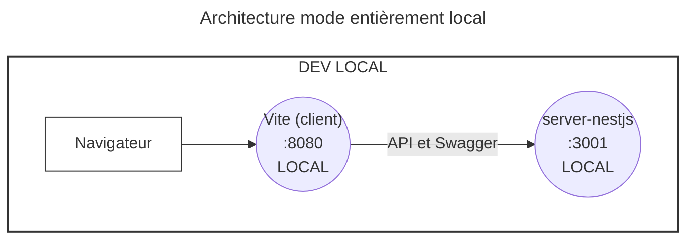
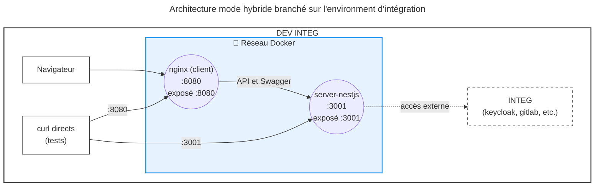

# Fichiers de configuration d'environnements

Cette documentation a pour but de détailler tout ce qui concerne la gestion des configuration d'environnements (appelé couramment "fichiers .env").

Comme vous aurez pu le constater, il y a beaucoup de choses à configurer pour un projet d'ampleur comme l'est la Console de CPiN, et il y a des cas d'usages très spécifiques qui seront décrits ici. Vous avez également la possibilité de composer votre propre manière de gérer vous variables d'environments en vous basant sur ce qui a été fait pour nous.

## Backend unique dans les stacks de développement et de CI

Le client joint directement `apps/server-nestjs` sur le port `3001` : via Vite en développement, ou via le Nginx client dans la stack CI.

```text
Navigateur → client:8080 → server-nestjs:3001
```

- API : `/api/*`. Swagger maintenu : `/swagger-ui-server-nestjs` et son document `-json`.
- Les réglages de proxy nécessaires restent dans le client : en-têtes de transfert, WebSocket et gros en-têtes Keycloak. Swagger legacy reste indisponible.
- Après mise à jour, adapter les fichiers actifs `apps/client/.env` et `.env.docker` : `SERVER_HOST=localhost` en natif, `SERVER_HOST=server-nestjs` dans Docker, `SERVER_PORT=3001` dans les deux cas. `init-env.sh` ne remplace pas les fichiers existants.
- Les sources legacy, du proxy et des anciens plugins sont retirées de l’arbre courant ; elles restent consultables dans l’historique Git. Un retour arrière exige les versions et configurations compatibles, sans garantie d’annulation des données ou des effets externes.
- Le chargement de plugins externes est retiré : il n’est plus utilisé depuis l’internalisation du module Observability. Aucun répertoire externe n’est nécessaire ; une éventuelle réintroduction sera une décision distincte, voir [#3005](https://github.com/cloud-pi-native/console/issues/3005).
- Le retrait en production, le chart et le guide opérationnel restent suivis par [#2895](https://github.com/cloud-pi-native/console/issues/2895). Cette configuration ne constitue pas une preuve de qualification en production.

---

## Cas d'usage supportés

Avant de décrire dans le détail comment configurer les différents environments, il est important de rappeler les Cas d'Usage qui sont supportés par les scripts de CPiN:

- **Développement totalement en local** : `client` et `server-nestjs` tournent nativement ; Docker fournit les dépendances.
- **Développement conteneurisé en local** : `client`, `server-nestjs` et les dépendances tournent dans Docker.
- **Développement conteneurisé hybride** : vous déployez localement seulement une partie de l'écosystème de `console` (`client` et/ou `server-nestjs`, de manière à utiliser votre code local) et pour le reste (Base de données de `console`, `keycloak`, `gitlab`, les clusters applicatifs, etc.), vous vous branchez à un environnement existant (appelé `integ` pour `INTEGRATION`). Ce cas d'usage est très pratique pour tester votre code avec de "vraies données" d'un environnement fonctionnel (comme notre environnement interne `cpin-hp`)
- Les cas de déploiements finaux du système complet, qui sont eux adressé par un chart Helm stocké dans [le dépôt `helm-charts`](https://github.com/cloud-pi-native/helm-charts)

Maintenant que ces définitions sont établies, passons à la configuration pour chacun des cas d'usage

## Considérations communes à tous les cas

Le mode de fonctionnement de la configuration des environnements est assez classique : les applications `client` et `server-nestjs` ont besoin d'avoir certaines variables d'environnements définies.

Le mécanisme de surcharge des différentes configurations fonctionne de cette manière :

```
->: «surcharge»

var d'env settée explicitement -> fichier .env.docker (si contexte docker) -> fichier .env.integ (si INTEGRATION=true) -> fichier .env
```

## Prégénération des fichiers .env, .env.docker, et .env.integ

Un script permet de copier facilement les fichiers `.env*-example` en leur équivalent `.env*`: [`./ci/scripts/init-env.sh`](./ci/scripts/init-env.sh).

> Il faut ensuite remplir ces fichiers, car ils ne sont là que simplement copiés avec les valeurs par défaut

## Configuration pour le développement entièrement en local

Le développement entièrement en local suit cette organisation des composants:



Docker Compose utilisé : [`docker/docker-compose.local.yml`](docker/docker-compose.local.yml) (infrastructure uniquement : Keycloak, PostgreSQL, pgAdmin, OpenCDS mock et Jaeger)

Fichiers utilisés :

- `apps/client/.env`
- `apps/server-nestjs/.env`

Les valeurs par défaut, disponibles dans les fichiers `.env-example`, sont suffisantes dans 99% des cas. Cela dit, c'est un cas d'usage assez restreint car la console se reposant sur quelques composants externes comme une base de données PostgreSQL ou un serveur IAM comme `keycloak`, il faut configurer manuellement les `.env` pour pointer sur les bonnes URLs, etc. Pas infaisable, mais pas très pratique au quotidien, hors des cas simple de build des applications.

**Commandes de lancement :**

```bash
# Lance l'infrastructure (Keycloak, PostgreSQL, pgAdmin, OpenCDS mock, Jaeger)
pnpm dev

# Puis dans d'autres terminaux, lancer le backend et le client :
pnpm --filter server-nestjs run start:dev
pnpm --filter client run dev
```

### Initialiser les données locales

Les migrations sont appliquées au démarrage de NestJS. L’import des données de démonstration n’est pas automatique : utiliser la commande explicite `db:fixtures --reset` uniquement sur une base jetable, backends arrêtés. Voir les [précautions et commandes](apps/server-nestjs/README.md#fixtures-de-développement-et-de-test).

La CI utilise le service ponctuel `fixtures` avant le démarrage de NestJS ; ne pas utiliser ses données pour un environnement d’intégration existant.

### Observabilité : Jaeger + OpenTelemetry (traces)

Le fichier [`docker/docker-compose.local.yml`](docker/docker-compose.local.yml) démarre un service `jaeger` (image `jaegertracing/all-in-one`) pour collecter et visualiser les traces.

- UI Jaeger : http://localhost:16686
- Endpoints de collecte exposés sur la machine hôte :
  - OTLP gRPC : `localhost:4317`
  - OTLP HTTP (protobuf) : `http://localhost:4318`

Dans `apps/server-nestjs`, l'instrumentation OpenTelemetry est initialisée au démarrage dans [`src/main.ts`](apps/server-nestjs/src/main.ts) et exporte via OTLP.

Pour vérifier rapidement :

1. Démarrer l'infra : `pnpm dev` (Jaeger inclus).
2. Démarrer `server-nestjs` : `pnpm --filter server-nestjs run start:dev`.
3. Exécuter une requête sur une route backend (depuis le client ou un `curl`).
4. Ouvrir http://localhost:16686 et chercher le service `cloud-pi-native-console`.

## Configuration pour le développement conteneurisé en local

Docker Compose utilisé : [`docker/docker-compose.dev.yml`](docker/docker-compose.dev.yml) (tout conteneurisé avec Docker Compose Watch)

Fichiers utilisés :

- `apps/client/.env`
- `apps/client/.env.docker`
- `apps/server-nestjs/.env`
- `apps/server-nestjs/.env.docker`

Cette configuration est déjà plus intéressante, car elle s'appuie sur les conteneurs définis dans [ce docker-compose](docker/docker-compose.dev.yml), qui lance notamment une base de données PostreSQL (ainsi qu'un `pgadmin`), et un serveur Keycloak préchargé avec un royaume qui contient un jeu de données. Le docker-compose contient des instructions `develop` qui permettent soit de synchroniser certains fichiers, soit de carrément reconstruire l'image et de relancer le service concerné. De cette manière vous pouvez développer en laissant les conteneurs tourner. C'est un peu moins performant qu'un travail totalement en local, mais ça a le mérite d'être plus proche du déploiement cible.

Le `client` attend que `server-nestjs` soit sain puis lui transmet directement les requêtes API. Les données locales restent persistantes ; aucun reset n’est déclenché au démarrage.

**Commande de lancement :**

```bash
# Lance l'ensemble des conteneurs (client, server-nestjs,
# keycloak, postgres, pgadmin, opencds mock) avec Docker Compose Watch
pnpm docker:dev
```

## Référence des variables d'environnement

### Variables communes

| Variable | Défaut | Description |
|----------|--------|-------------|
| `NODE_ENV` | `development` | Mode d'exécution : `development`, `production`, `test` |
| `SERVER_HOST` | `localhost` | Interface d'écoute du serveur (NestJS) |
| `SERVER_PORT` | `0` (dynamique) | Port du serveur (NestJS) |
| `SESSION_SECRET` | — | Secret de signature des cookies de session (min 32 caractères) |
| `CONTACT_EMAIL` | `cloudpinative-relations@interieur.gouv.fr` | Email de contact affiché dans l'interface |

### Intégration / CI

| Variable | Défaut | Description |
|----------|--------|-------------|
| `INTEGRATION` | — | Active le mode intégration (`true`) |
| `CI` | — | Active le mode CI (`true`) |
| `APP_VERSION` | `unknown` | Version de l'application (prod uniquement) |

---

### Variables Keycloak

| Variable | Défaut | Description |
|----------|--------|-------------|
| `KEYCLOAK_PROTOCOL` | — | Protocole : `http` ou `https` |
| `KEYCLOAK_DOMAIN` | — | Domaine Keycloak (host:port) |
| `KEYCLOAK_PUBLIC_PROTOCOL` | `KEYCLOAK_PROTOCOL` | Protocole exposé publiquement |
| `KEYCLOAK_PUBLIC_DOMAIN` | `KEYCLOAK_DOMAIN` | Domaine exposé publiquement |
| `KEYCLOAK_REALM` | — | Nom du royaume |
| `KEYCLOAK_CLIENT_ID` | — | Client ID côté backend |
| `KEYCLOAK_CLIENT_SECRET` | — | Secret du client backend |
| `KEYCLOAK_ADMIN` | — | Identifiant admin Keycloak |
| `KEYCLOAK_ADMIN_PASSWORD` | — | Mot de passe admin Keycloak |
| `KEYCLOAK_ADMIN_CLIENT_ID` | `admin-cli` | Client admin pour le royaume master |
| `KEYCLOAK_REDIRECT_URI` | — | URL de redirection post-auth |
| `KEYCLOAK_JWKS_CACHE_TTL_MS` | `300000` (5 min) | Cache TTL des JWKS en ms |
| `KEYCLOAK_JWKS_TIMEOUT_MS` | `5000` (5 s) | Timeout de fetch JWKS en ms |
| `KEYCLOAK_OPENID_CONFIGURATION_CACHE_TTL_MS` | `300000` (5 min) | Cache TTL openid-configuration en ms |
| `ADMIN_KC_USER_ID` | — | IDs des admins Keycloak (liste CSV) |

### Variables Base de données

| Variable | Défaut | Description |
|----------|--------|-------------|
| `DB_URL` | — | URL PostgreSQL (Prisma) |

### Variables client (Vite)

| Variable | Défaut | Description |
|----------|--------|-------------|
| `SERVER_HOST` | `localhost` | Hôte cible du proxy Vite (`server-nestjs` dans Docker) |
| `SERVER_PORT` | `3001` | Port cible du proxy Vite |
| `VITE_KEYCLOAK_DOMAIN` | — | Domaine Keycloak (client) |
| `VITE_KEYCLOAK_REALM` | — | Royaume Keycloak (client) |
| `VITE_KEYCLOAK_PROTOCOL` | — | Protocole Keycloak (client) |
| `VITE_KEYCLOAK_CLIENT_ID` | — | Client ID Keycloak (client) |
| `VITE_KEYCLOAK_REDIRECT_URI` | `http://localhost:8080` | URL de redirection post-auth (client) |
| `VITE_OPENCDS_ENABLED` | `false` | Active le module OpenCDS (client) |
| `VITE_CONTACT_EMAIL` | — | Email de contact (client) |

---

### Variables ArgoCD

| Variable | Défaut | Description |
|----------|--------|-------------|
| `USE_ARGOCD` | `false` | Active le plugin ArgoCD (`true`) |
| `ARGO_NAMESPACE` | `argocd` | Namespace ArgoCD |
| `ARGOCD_URL` | — | URL publique ArgoCD |
| `ARGOCD_INTERNAL_URL` | — | URL interne ArgoCD |
| `ARGOCD_EXTRA_REPOSITORIES` | — | Répôts additionnels (JSON) |
| `ARGOCD_SHARED_SOURCE_REPOSITORIES` | — | Sources autorisées pour tous les projets, `<project>` remplacé par le slug (ex. `oci://registry.example.com/<project>/**`) |

### Variables GitLab

| Variable | Défaut | Description |
|----------|--------|-------------|
| `USE_GITLAB` | `false` | Active le plugin GitLab (`true`) |
| `GITLAB_URL` | — | URL publique GitLab |
| `GITLAB_INTERNAL_URL` | — | URL interne GitLab |
| `GITLAB_TOKEN` | — | Token d'authentification |
| `GITLAB_MIRROR_TOKEN_EXPIRATION_DAYS` | `180` | Durée avant rotation token mirror (jours) |
| `GITLAB_MIRROR_TOKEN_ROTATION_THRESHOLD_DAYS` | `90` | Seuil de rotation token mirror (jours) |

### Variables Harbor (Registry)

| Variable | Défaut | Description |
|----------|--------|-------------|
| `USE_HARBOR` | `false` | Active le plugin Harbor (`true`) |
| `HARBOR_URL` | — | URL publique Harbor |
| `HARBOR_INTERNAL_URL` | — | URL interne Harbor |
| `HARBOR_ADMIN` | — | Identifiant administrateur Harbor |
| `HARBOR_ADMIN_PASSWORD` | — | Mot de passe administrateur Harbor |
| `HARBOR_RULE_TEMPLATE` | — | Template de règle de rétention |
| `HARBOR_RULE_COUNT` | — | Nombre de règles de rétention |
| `HARBOR_RETENTION_CRON` | `0 22 2 * * *` | Cron de nettoyage Harbor |
| `HARBOR_ROBOT_ROTATION_THRESHOLD_DAYS` | `90` | Seuil de rotation des robots (jours) |
| `HARBOR_PROJECT_SLUG_CACHE_TTL_MS` | `300000` (5 min) | Cache TTL des slugs projet (ms) |

### Variables Nexus

| Variable | Défaut | Description |
|----------|--------|-------------|
| `USE_NEXUS` | `false` | Active le plugin Nexus (`true`) |
| `NEXUS_URL` | — | URL publique Nexus |
| `NEXUS_INTERNAL_URL` | — | URL interne Nexus |
| `NEXUS_ADMIN` | — | Identifiant administrateur Nexus |
| `NEXUS_ADMIN_PASSWORD` | — | Mot de passe administrateur Nexus |
| `NEXUS__SECRET_EXPOSE_INTERNAL_URL` | — | Expose l'URL interne comme URL secrète (`true`) |

### Variables SonarQube

| Variable | Défaut | Description |
|----------|--------|-------------|
| `USE_SONARQUBE` | `false` | Active le plugin SonarQube (`true`) |
| `SONARQUBE_URL` | — | URL publique SonarQube |
| `SONARQUBE_INTERNAL_URL` | — | URL interne SonarQube |
| `SONAR_API_TOKEN` | — | Token d'API SonarQube |

### Variables Observability (Grafana)

| Variable | Default | Description |
||----------|--------|-------------|
|| `USE_OBSERVABILITY` | `false` | Active le plugin Observability/Grafana (`true`) |
|| `GRAFANA_URL` | — | URL publique Grafana |
|| `DSO_OBSERVABILITY_CHART_VERSION` | `dso-observability-0.1.7` | Version du chart Helm dso-observability |

### Variables Service Chain

| Variable | Défaut | Description |
|----------|--------|-------------|
| `USE_SERVICE_CHAIN` | `false` | Active le plugin Service Chain (`true`) |
| `OPENCDS_URL` | — | URL de l'API OpenCDS |
| `OPENCDS_API_TOKEN` | — | Token d'authentification |
| `OPENCDS_API_TLS_REJECT_UNAUTHORIZED` | `true` | Vérification TLS (true / false) |

### Variables Vault

| Variable | Défaut | Description |
|----------|--------|-------------|
| `USE_VAULT` | `false` | Active le plugin Vault (`true`) |
| `VAULT_URL` | — | URL publique Vault |
| `VAULT_INTERNAL_URL` | — | URL interne Vault |
| `VAULT_TOKEN` | — | Token de service Vault |
| `VAULT_KV_NAME` | `forge-dso` | Nom du secret KV Vault |
| `VAULT__DEPLOY_VAULT_CONNECTION_IN_NS` | — | Déploie la connexion Vault dans les namespaces (`true`) |

### Variables DSO (Environnements)

| Variable | Défaut | Description |
|----------|--------|-------------|
| `DSO_ENV_CHART_VERSION` | `dso-env-1.6.0` | Version du chart dso-env |
| `DSO_NS_CHART_VERSION` | `dso-ns-1.1.5` | Version du chart dso-ns |

### Racine des projets

| Variable | Défaut | Description |
|----------|--------|-------------|
| `PROJECTS_ROOT_DIR` | — | Dossier racine des projets |

### Variables E2E (tests)

| Variable | Défaut | Description |
|----------|--------|-------------|
| `E2E` | — | Active les tests E2E (`true`) |

---

## Configuration pour le développement hybride avec un environnement d'intégration existant

Le développement hybride branché sur l'environnement d'intégration suit cette organisation des composants:



Docker Compose utilisé : [`docker/docker-compose.integ.yml`](docker/docker-compose.integ.yml) (sans Keycloak, branché sur l'environnement d'intégration distant)

Fichiers utilisés :

- `apps/client/.env`
- `apps/client/.env.docker`
- `apps/client/.env.integ`
- `apps/server-nestjs/.env`
- `apps/server-nestjs/.env.docker`
- `apps/server-nestjs/.env.integ`

Cette configuration est une itération de la précédente. Dans ce cas d'usage le Keycloak n'est pas créé en tant que conteneur, car on est supposé se brancher sur l'environnement d'intégration défini dans les fichiers `.env.integ`. Le contenu de `apps/server-nestjs/.env.integ` configure aussi les volumes de Compose : renseigner notamment `KUBECONFIG_HOST_PATH` avant le lancement.

**Commandes de lancement :**

```bash
# Option 1 : Tout conteneurisé, branché sur l'environnement d'intégration
pnpm docker:integ

# Option 2 : Seulement l'infra en Docker (postgres, pgadmin), NestJS et client en local
pnpm integ
# Puis dans d'autres terminaux :
pnpm --filter server-nestjs run integ
pnpm --filter client run integ
```
