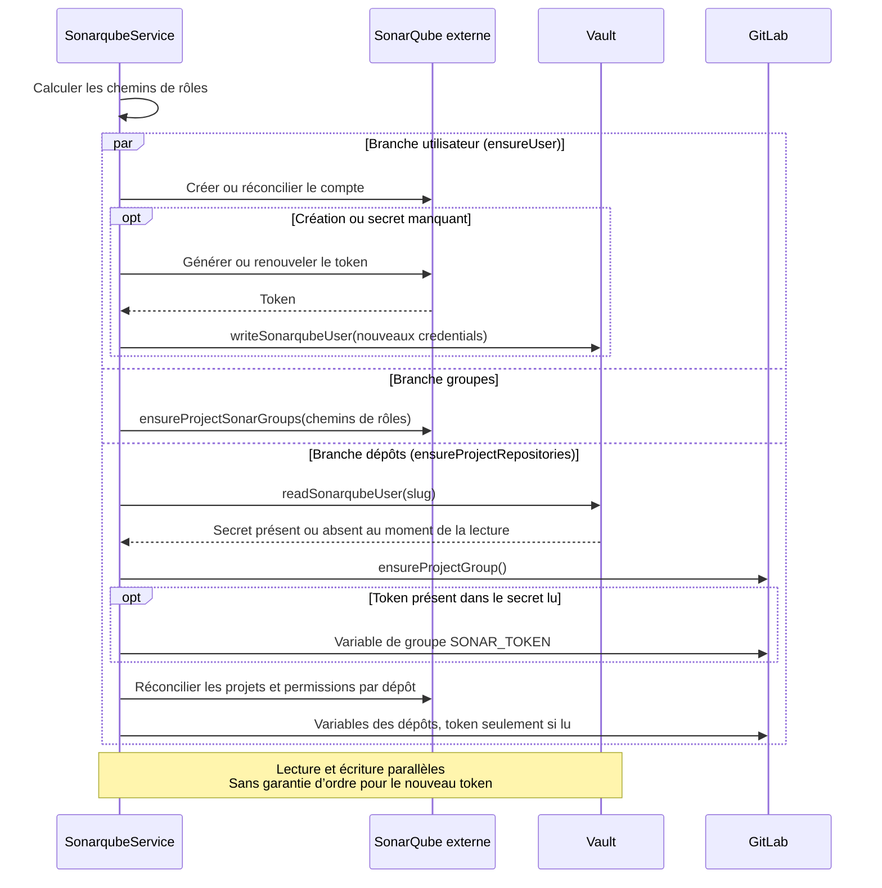

# SonarQube

[← Index transversal de la cartographie](../../../../../docs/architecture/plugins.md)

## Périmètre et état de migration

Le module `sonarqube` provisionne utilisateurs, tokens, projets, permissions et groupes SonarQube, et prépare les variables d’analyse dans GitLab. Plugin historique : `plugins/sonarqube/src/`.

## Relations observées

### Sorties

| Fournisseur       | Finalité métier                                                                  | Nature                     | Mécanisme observé                                                                                                                     | Entrées → sorties                                                                                                 |
| ----------------- | -------------------------------------------------------------------------------- | -------------------------- | ------------------------------------------------------------------------------------------------------------------------------------- | ----------------------------------------------------------------------------------------------------------------- |
| Vault             | Stocker/récupérer les identifiants de l’utilisateur SonarQube et son token.      | fonctionnelle et technique | `VaultClientService` injecté et méthodes `readSonarqubeUser`, `writeSonarqubeUser`, `deleteSonarqubeUser`.                            | projet → secret SonarQube, utilisé pendant la synchronisation.                                                    |
| GitLab            | Configurer dépôt d’analyse et variables de groupe/dépôt pour exécuter l’analyse. | fonctionnelle et technique | Injection `GitlabClientService`.                                                                                                      | projet + repository + projet SonarQube → dépôt système/analyse et variables CI `PROJECT_KEY`, `SONAR_TOKEN`, etc. |
| SonarQube externe | Gérer utilisateurs, tokens, groupes, projets et permissions.                     | fonctionnelle et technique | `SonarqubeClientService`.                                                                                                             | projet et repositories → ressources SonarQube.                                                                    |
| Événements projet | Déclencher la synchronisation et la suppression des ressources.                  | fonctionnelle et technique | Écoute `project.upsert` et `project.delete`, résultats capturés.                                                                      | `ProjectWithDetails` → résultat SonarQube OK/KO.                                                                  |
| Groupes Keycloak  | Définir les permissions SonarQube des profils projet/plateforme.                 | fonctionnelle et technique | Chemins de rôles calculés localement par `getProjectRoleGroupPaths`, groupes SonarQube et permissions appliqués sans client Keycloak. | slug + suffixes configurés → chemins OIDC, groupes et permissions SonarQube.                                      |

### Entrées

- `project.upsert` synchronise le groupe de projet, les repositories, permissions et variables GitLab, ainsi que l’utilisateur/token Vault/SonarQube.
- `project.delete` nettoie les ressources projet SonarQube et les credentials associés dans Vault.
- Observability n’est pas un dépendant SonarQube prouvé dans le code étudié.
- Le plugin historique consomme `VaultProjectApi` pour le secret `SONAR` et `KeycloakProjectApi.getProjectGroupPath()` pour calculer le groupe racine `/<slug>` puis lui accorder les permissions. NestJS conserve les appels directs Vault/GitLab et le couplage fonctionnel Keycloak par convention de nommage, sans injection Keycloak : il calcule des chemins de rôles admin/devops/developer/security/readonly et leur attribue des permissions différenciées, avec des groupes plateforme. Le delta porte sur cette granularité des droits, pas sur une absence de provisioning de permissions.

## Séquences métier

- **Réconciliation projet** : `ensureProjectGroup` calcule les chemins de rôles puis lance un `Promise.all` de trois branches : `ensureUser`, `ensureProjectSonarGroups` et `ensureProjectRepositories`. La branche utilisateur crée/répare le compte et écrit ses nouveaux credentials dans Vault si nécessaire ; la branche groupes crée les groupes SonarQube ; la branche dépôts relit `readSonarqubeUser` indépendamment, crée/réconcilie les projets et permissions puis configure GitLab. Il n’existe pas de séquence garantie « écrire le token puis le relire ».
- **Distribution du token** : la branche dépôts obtient le groupe renvoyé par `GitlabClientService.ensureProjectGroup()`, publie `SONAR_TOKEN` au niveau groupe si le secret lu le contient, puis configure les variables de chaque dépôt (dont le token seulement s’il a été lu). Création/rotation et lecture s’exécutent sans garantie d’ordre : la lecture peut précéder l’écriture, omettre le nouveau token ou conserver l’ancien. La création des groupes et l’attribution des permissions sont elles aussi parallèles.
- **Déprovisionnement** : supprimer les projets/utilisateur/permissions du projet SonarQube puis supprimer les credentials SonarQube de Vault.
- **Orphan repositories** : comparer les projets SonarQube présents à la liste actuelle de dépôts Console et supprimer les projets d’analyse orphelins ; cette opération reste interne à la réconciliation SonarQube.

## Contrats cibles recommandés et delta

| Couture observée                                                                                                                                     | Propriétaire cible                                                                                     | Contrat recommandé (proposition)                                                                                                               | Garanties                                                                                                                      | Delta                                                                                                                                                                                                                                                                            |
| ---------------------------------------------------------------------------------------------------------------------------------------------------- | ------------------------------------------------------------------------------------------------------ | ---------------------------------------------------------------------------------------------------------------------------------------------- | ------------------------------------------------------------------------------------------------------------------------------ | -------------------------------------------------------------------------------------------------------------------------------------------------------------------------------------------------------------------------------------------------------------------------------- |
| SonarQube manipule directement le client GitLab pour créer des dépôts/variables de pipeline.                                                         | GitLab possède groupes, dépôts et variables ; SonarQube décrit l’intention de configuration d’analyse. | Contrat GitLab `configureSonarAnalysis(project, repository, projectKey, tokenRef)` ou opérations minimales spécialisées de dépôt et variables. | Secrets masqués et scopes explicites ; idempotence ; aucun type SDK GitLab dans le contrat ; nettoyage lors d’une suppression. | Remplacer `GitlabClientService` et construire un port d’intention SonarQube dans GitLab ; préciser la gestion du token partagé groupe et celui des variables dépôt. Statut : `à arbitrer`.                                                                                       |
| `ensureUser` écrit les credentials pendant que `ensureProjectRepositories` relit Vault et distribue le token aux variables GitLab.                   | SonarQube possède création/rotation ; Vault stocke le secret ; GitLab possède les variables CI.        | Orchestration explicite « obtenir les credentials convergés puis distribuer leur référence/valeur minimale », sans type Vault générique.       | Écriture achevée avant lecture/distribution, rotation répercutée, masquage/scopes, absence de secrets dans les logs.           | Le `Promise.all` actuel ne garantit pas cet ordre ; une lecture peut manquer le nouveau token ou publier l’ancien. Ordonner ces étapes et tester création/rotation ; préciser scope groupe/dépôt et nettoyage. Problème applicatif observé, non corrigé par cette documentation. |
| Le legacy accorde les permissions au groupe racine `/<slug>` ; NestJS utilise des chemins de rôles calculés et des jeux de permissions différenciés. | Keycloak possède les groupes ; SonarQube possède leurs permissions d’analyse.                          | Convention partagée de chemins ou requête ciblée si nécessaire, sans API plugin/SDK.                                                           | Alignement avec les groupes réellement provisionnés et permissions explicites pour chaque profil.                              | L’appel direct a disparu, pas le couplage fonctionnel. Qualifier la correspondance des droits legacy/rôles et les utilisateurs sans rôle ; centraliser le nommage si nécessaire. Statut : `à qualifier` pour les droits, `cible proposée` pour le port.                          |

## Preuves et limites

- `sonarqube.module.ts` importe `GitlabModule` et `VaultModule`, pas `KeycloakModule`.
- `sonarqube.service.ts` injecte GitLab et Vault, écoute `project.upsert`/`project.delete` ; `ensureProjectGroup` lance le `Promise.all` de `ensureUser`, `ensureProjectSonarGroups` et `ensureProjectRepositories`. `ensureUser` écrit le secret, tandis que `ensureProjectRepositories` le relit et `ensureGitlabCiVariables` consomme cette lecture, sans attente entre les deux branches.
- `sonarqube-client.service.ts` porte les appels SonarQube ; `sonarqube.constants.ts` définit les permissions/groupes utilisés.
- `plugins/sonarqube/src/functions.ts` utilise `KeycloakProjectApi.getProjectGroupPath()`, `VaultProjectApi` pour le secret `SONAR`, et GitLab/Vault dans `setVariables`. `plugins/sonarqube/src/project.ts:ensureRepositoryConfiguration` applique les permissions au groupe racine ; `plugins/keycloak/src/class.ts` en construit le chemin sans appel externe.
- `sonarqube.service.ts` (`getProjectRoleGroupPaths`, `generateProjectRoleGroupPath`, `ensureProjectPermissions`, `buildGroupPermissions`) et `sonarqube.constants.ts` prouvent les chemins locaux et les permissions par profil NestJS. Ils établissent un changement de granularité, pas une absence de relation fonctionnelle Keycloak.
