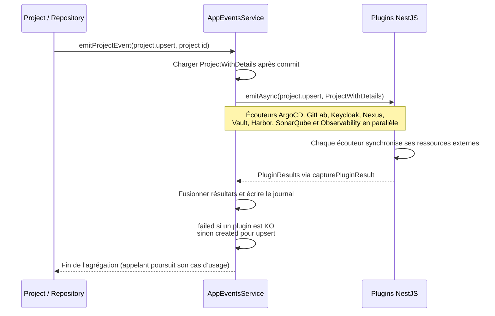
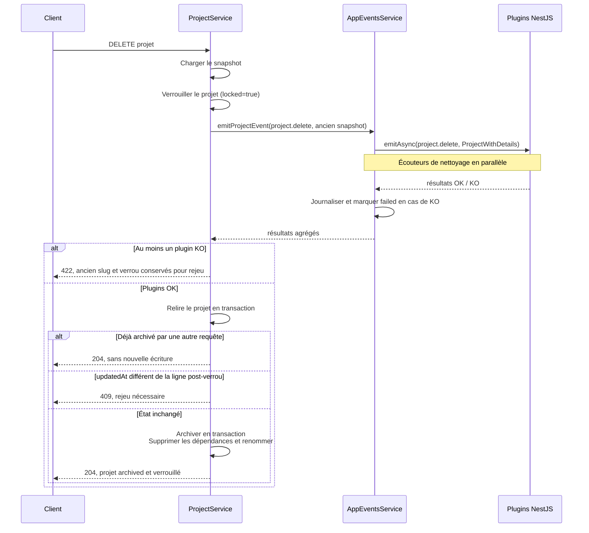
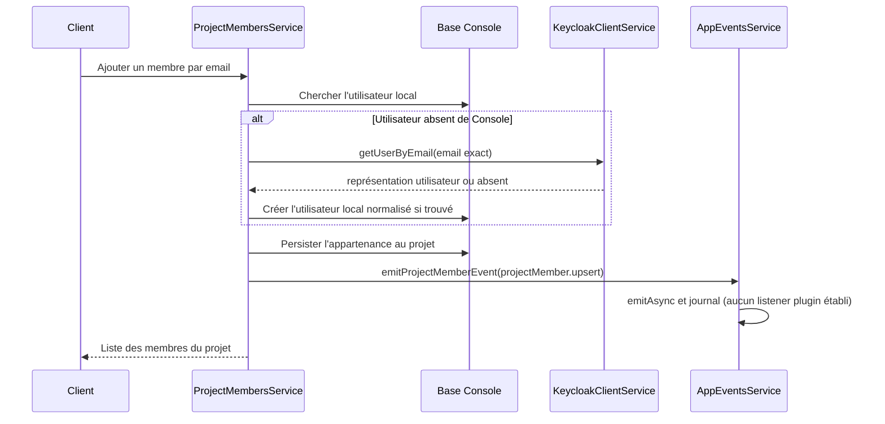
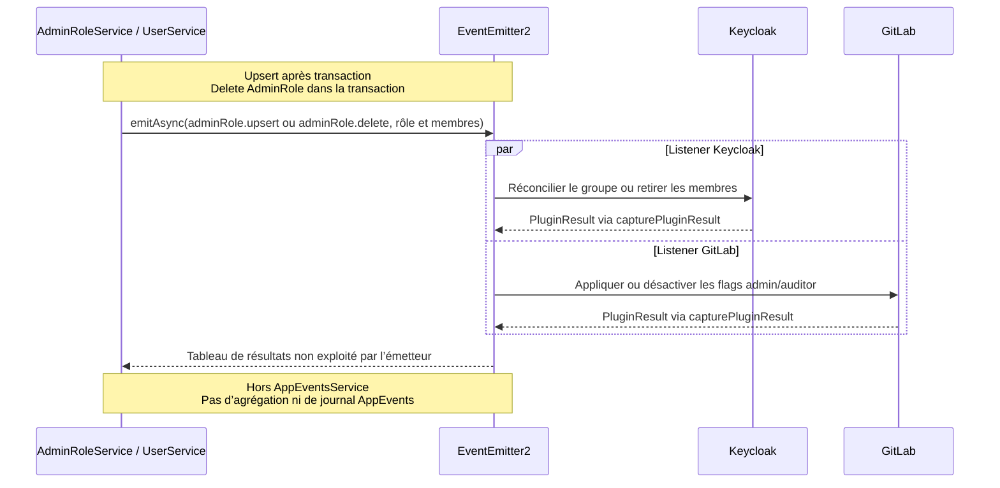
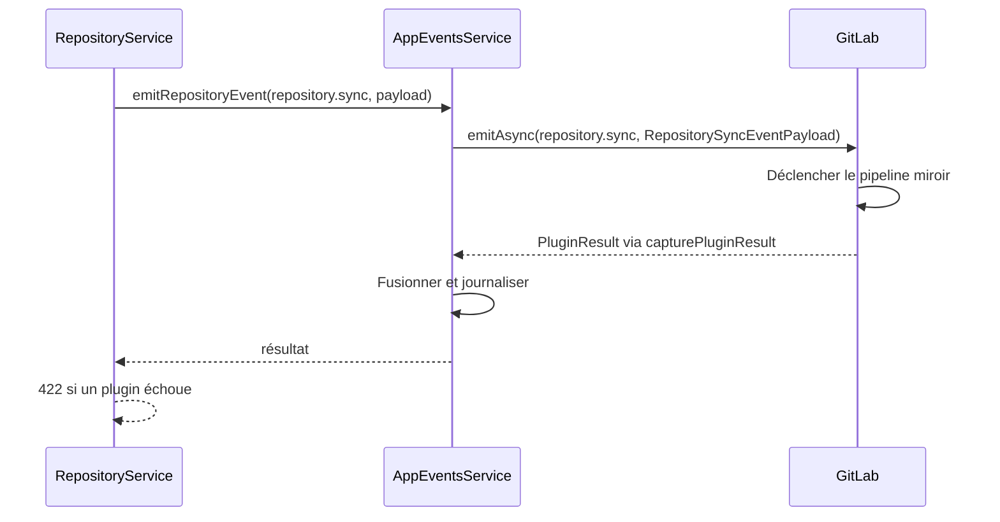
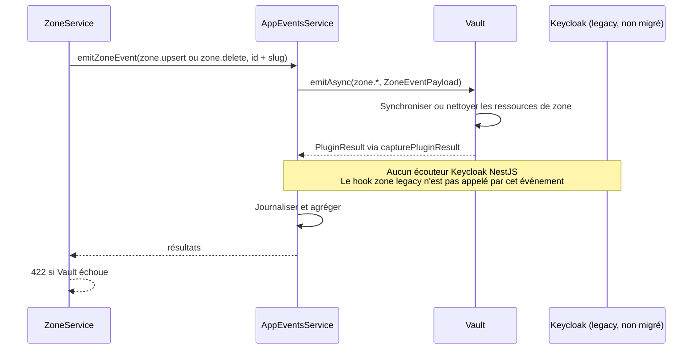
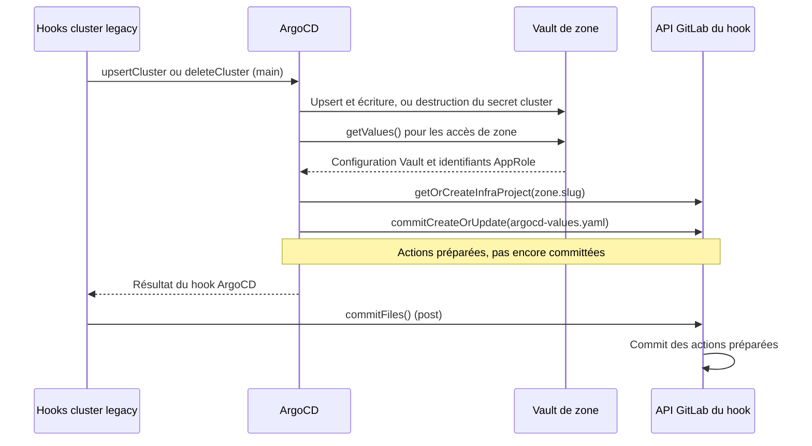

# Cartographie des modules/plugins

Cette cartographie décrit les interactions entre les plugins historiques et leurs modules NestJS de remplacement, distingue l’état observé des contrats cibles recommandés et rend leur delta explicite. Elle couvre les sept modules hérités : ArgoCD, GitLab, Keycloak, Nexus, Vault, Harbor et SonarQube. Le code de Harbor est porté par le module NestJS `registry`.

Les documents de module, colocalisés au code, sont la référence détaillée des coutures. Les dépendances sortantes sont prouvées dans le README du consommateur ; le README du fournisseur en donne une synthèse entrante et renvoie à cette preuve.

L’état observé est confronté au [code de référence `2de2d8378`](https://github.com/cloud-pi-native/console/tree/2de2d8378d6e7efdab7999524feaf21e73091e0d). Les fiches se lisent avec ce même instantané ; les migrations encore ouvertes citées plus bas ne sont pas assimilées à du code livré.

## Lire la cartographie

- **Fonctionnelle** : une capacité métier d’un module permet ou complète celle d’un autre.
- **Technique** : la relation est matérialisée par une injection NestJS, un appel de client, un événement, un type, un secret, une persistance ou une API externe.
- Une relation peut être **fonctionnelle et technique**. La nature technique ne remplace pas l’explication de la finalité métier.
- **État observé** : fait étayé par un fichier et un symbole cités. `NestJS direct` désigne un appel inter-module observé ; `événement` désigne un découplage par événement ; `legacy à qualifier` désigne une référence historique dont l’usage runtime n’est pas établi par la seule déclaration.
- **Convention de nommage** : un consommateur construit localement un chemin de groupe que Keycloak provisionne. L’absence d’import de `KeycloakModule` supprime l’appel direct, pas le couplage fonctionnel ; comparer chemins et permissions avant de conclure à un manque de portage.
- **Cible recommandée** : proposition d’architecture, non implémentée. Le **delta** indique ce qu’il faudrait remplacer, ajouter ou qualifier.
- **Statuts du delta** : `à arbitrer` = décision d’architecture à prendre ; `cible proposée` = solution recommandée, non adoptée ; `à porter` = comportement legacy à migrer (`à porter ou retirer explicitement` laisse ouverte une décision de retrait) ; `à investiguer` = usage ou besoin à établir ; `à qualifier` = correspondance des comportements ou droits à vérifier. Ces statuts ne fixent ni priorité ni échéance.

## Documents par module

- [ArgoCD](../../apps/server-nestjs/src/modules/integrations/argocd/README.md)
- [GitLab](../../apps/server-nestjs/src/modules/integrations/gitlab/README.md)
- [Keycloak](../../apps/server-nestjs/src/modules/integrations/keycloak/README.md)
- [Nexus](../../apps/server-nestjs/src/modules/integrations/nexus/README.md)
- [Vault](../../apps/server-nestjs/src/modules/integrations/vault/README.md)
- [Harbor — module `registry`](../../apps/server-nestjs/src/modules/integrations/registry/README.md)
- [SonarQube](../../apps/server-nestjs/src/modules/integrations/sonarqube/README.md)

## Matrice des coutures observées

| Consommateur                                   | Fournisseur / déclencheur                                                                | Finalité                                                                                       | Nature                     | État observé                                                                                                                     | Détail                                                                |
| ---------------------------------------------- | ---------------------------------------------------------------------------------------- | ---------------------------------------------------------------------------------------------- | -------------------------- | -------------------------------------------------------------------------------------------------------------------------------- | --------------------------------------------------------------------- |
| ArgoCD                                         | GitLab                                                                                   | Lire et committer les fichiers de configuration de déploiement par zone.                       | fonctionnelle et technique | NestJS direct (`GitlabClientService`) ; API GitLab de plugin en legacy                                                           | [ArgoCD](../../apps/server-nestjs/src/modules/integrations/argocd/README.md)       |
| ArgoCD                                         | Vault                                                                                    | Obtenir role-id / secret-id AppRole et configurer l’accès Vault pour le déploiement.           | fonctionnelle et technique | NestJS direct (`VaultClientService`) ; API projet/zone Vault en legacy                                                           | [ArgoCD](../../apps/server-nestjs/src/modules/integrations/argocd/README.md)       |
| GitLab                                         | Vault                                                                                    | Stocker/lire identifiants de miroirs, tokens et secrets GitLab du plugin.                      | fonctionnelle et technique | NestJS direct (`VaultClientService`) ; API projet Vault en legacy                                                                | [GitLab](../../apps/server-nestjs/src/modules/integrations/gitlab/README.md)       |
| Nexus                                          | Vault                                                                                    | Persister et retrouver le mot de passe du compte Nexus de projet.                              | fonctionnelle et technique | NestJS direct (`VaultClientService`) ; API injectée Vault en legacy                                                              | [Nexus](../../apps/server-nestjs/src/modules/integrations/nexus/README.md)         |
| Harbor (`registry`)                            | Vault                                                                                    | Persister et retrouver les secrets de robots du registre.                                      | fonctionnelle et technique | NestJS direct (`VaultClientService`) ; API projet Vault en legacy                                                                | [Harbor](../../apps/server-nestjs/src/modules/integrations/registry/README.md)     |
| SonarQube                                      | GitLab                                                                                   | Créer le dépôt d’analyse et y gérer ses variables de configuration.                            | fonctionnelle et technique | NestJS direct (`GitlabClientService`) ; API GitLab en legacy                                                                     | [SonarQube](../../apps/server-nestjs/src/modules/integrations/sonarqube/README.md) |
| SonarQube                                      | Vault                                                                                    | Persister et retrouver le secret de l’utilisateur SonarQube de projet.                         | fonctionnelle et technique | NestJS direct (`VaultClientService`) ; API de projet Vault en legacy                                                             | [SonarQube](../../apps/server-nestjs/src/modules/integrations/sonarqube/README.md) |
| SonarQube                                      | Groupes Keycloak                                                                         | Configurer les permissions d’analyse à partir des groupes d’identité.                          | fonctionnelle et technique | Legacy : chemin racine via `getProjectGroupPath()` ; NestJS : chemins de rôles construits localement, permissions différenciées. | [SonarQube](../../apps/server-nestjs/src/modules/integrations/sonarqube/README.md) |
| Harbor (`registry`)                            | Groupes Keycloak                                                                         | Ajouter le groupe OIDC projet et les groupes de rôles comme membres Harbor.                    | fonctionnelle et technique | Legacy : `getProjectGroupPath()` ; NestJS : `/${project.slug}` et chemins de rôles calculés localement, sans injection Keycloak. | [Harbor](../../apps/server-nestjs/src/modules/integrations/registry/README.md)     |
| ArgoCD                                         | Groupes Keycloak                                                                         | Inscrire les chemins RO/RW des groupes d’environnement dans les manifests.                     | fonctionnelle et technique | Legacy : `getEnvGroup()` ; NestJS : mêmes chemins `/<slug>/console/<env>/RO` et `RW` calculés localement.                        | [ArgoCD](../../apps/server-nestjs/src/modules/integrations/argocd/README.md)       |
| Keycloak (legacy)                              | Vault                                                                                    | Persister le secret du client OIDC créé pour une zone.                                         | fonctionnelle et technique | API Vault de zone `write(..., 'keycloak')` ; absent du module Keycloak NestJS                                                    | [Keycloak](../../apps/server-nestjs/src/modules/integrations/keycloak/README.md)   |
| Zone → Keycloak (legacy)                       | Keycloak                                                                                 | Provisionner/supprimer le client OIDC ArgoCD associé à la zone.                                | fonctionnelle et technique | Hooks `upsertZone`/`deleteZone` legacy ; `zone.*` NestJS n’a pas de consommateur Keycloak                                        | [Keycloak](../../apps/server-nestjs/src/modules/integrations/keycloak/README.md)   |
| Observability (hors périmètre des sept fiches) | GitLab                                                                                   | Gérer dépôt chart et configuration du projet Observability.                                    | fonctionnelle et technique | NestJS direct (`GitlabClientService`)                                                                                            | [GitLab](../../apps/server-nestjs/src/modules/integrations/gitlab/README.md)       |
| Observability (hors périmètre des sept fiches) | Keycloak                                                                                 | Gérer groupes et membres RBAC Grafana.                                                         | fonctionnelle et technique | NestJS direct (`KeycloakClientService`)                                                                                          | [Keycloak](../../apps/server-nestjs/src/modules/integrations/keycloak/README.md)   |
| ProjectMembers (module métier)                 | Keycloak                                                                                 | Résoudre une identité absente de Console par courriel exact lors d’un ajout de membre.         | fonctionnelle et technique | NestJS direct (`getUserByEmail`)                                                                                                 | [Keycloak](../../apps/server-nestjs/src/modules/integrations/keycloak/README.md)   |
| Repository (module métier)                     | Vault                                                                                    | Persister ou retirer les credentials de miroir avant la réconciliation GitLab.                 | fonctionnelle et technique | Injection optionnelle `VaultClientService` ; `writeGitlabMirrorCreds` / `deleteGitlabMirrorCreds`.                               | [GitLab](../../apps/server-nestjs/src/modules/integrations/gitlab/README.md)       |
| Keycloak / GitLab                              | AdminRole et User via `EventEmitter2`                                                    | Réconcilier les appartenances des rôles administrateurs et les flags admin/auditor GitLab.     | fonctionnelle et technique | `adminRole.upsert` / `adminRole.delete`, listeners capturés, hors `AppEventsService`.                                            | [Rôles administrateurs](#synchroniser-les-rôles-administrateurs)      |
| ProjectMembers → Keycloak (legacy)             | Hooks membre                                                                             | Ajouter/retirer les appartenances de rôles et révoquer les groupes du projet à la suppression. | fonctionnelle et technique | Hooks `upsertProjectMember` / `deleteProjectMember` établis en legacy, aucun consommateur NestJS `projectMember.*`.              | [Keycloak](../../apps/server-nestjs/src/modules/integrations/keycloak/README.md)   |
| Zone → GitLab (legacy)                         | Hooks zone                                                                               | Créer ou supprimer le dépôt d’infrastructure de zone.                                          | fonctionnelle et technique | `upsertZone` / `deleteZone` ; pont NestJS suivi dans #2864 et #2807, non livré dans l’instantané.                                | [GitLab](../../apps/server-nestjs/src/modules/integrations/gitlab/README.md)       |
| Zone / Cluster → ArgoCD (legacy)               | GitLab et Vault                                                                          | Mettre à jour les valeurs ArgoCD de zone et les credentials de cluster.                        | fonctionnelle et technique | `updateZoneValues`, `upsertCluster` / `deleteCluster`, sans équivalent dans le module ArgoCD NestJS observé.                     | [ArgoCD](../../apps/server-nestjs/src/modules/integrations/argocd/README.md)       |
| Consommateurs projet/dépôt/zone                | `AppEventsService`                                                                       | Déclencher la réconciliation ou le nettoyage de ressources métier.                             | fonctionnelle et technique | `project.*`, `repository.sync`, `zone.*` : résultats capturés, agrégés et journalisés.                                           | [Séquences](#séquences-métier-transverses)                            |
| Modules consommateurs                          | Modules métier (`project`, `repository`, `zone`, `projectMembers`, `admin-role`, `user`) | Recevoir l’état métier, de membre ou de rôle concerné.                                         | fonctionnelle et technique | Charges utiles typées ; circuit AppEvents ou émission directe selon l’événement.                                                 | [Séquences](#séquences-métier-transverses)                            |

La présence d’une dépendance technique dans la matrice ne vaut pas preuve d’un contrat stable. Les imports legacy type-only ou déclaratifs sont qualifiés dans les fiches et ne sont pas assimilés à des appels NestJS.

## Séquences métier transverses

Pour la création/mise à jour et les mutations de ressources projet, `project.upsert` est émis après persistance. L’archivage émet au contraire `project.delete` avant la transaction finale de suppression des dépendances et de renommage, avec l’ancien snapshot. `AppEventsService` attend `EventEmitter2.emitAsync`, fusionne les résultats des écouteurs et écrit un journal. Les écouteurs s’exécutent en parallèle, sans ordre garanti entre plugins ; `capturePluginResult` transforme chaque succès/exception en résultat `OK` ou `KO`.

Ce circuit couvre `project.*`, `repository.sync`, `zone.*` et les événements membres journalisés sans listener plugin. Les événements `adminRole.*` utilisent directement `EventEmitter2` : leur traitement distinct est décrit ci-dessous.

### Réconcilier un projet

Les émetteurs observés incluent création/mise à jour projet, changements de dépôts, rôles, environnements et déploiements, ainsi que le rejeu des hooks projet. Les écouteurs `project.upsert` actuellement présents sont ArgoCD, GitLab, Keycloak, Nexus, Vault, Harbor/Registry, SonarQube et Observability.

Les modifications dépôt modifient d’abord les données et peuvent aussi appliquer l’intention de credentials dans Vault, puis réconcilient le projet. Selon l’opération, le demandeur reçoit une erreur 422 si un plugin est KO ; voir la séquence dépôt ci-dessous.

### Déprovisionner un projet

`ProjectService.archive` charge l’état projet puis pose `locked: true` avant d’émettre `project.delete` sur l’ancien snapshot, encore pourvu de ses dépôts/environnements et de son slug. Le nettoyage externe précède l’archivage. Un résultat plugin KO marque le projet `failed` et provoque une 422, sans renommer le projet ni supprimer ses dépendances. Un nouveau DELETE permet le rejeu du nettoyage ; le verrou reste posé, avec déverrouillage administrateur possible.

Après succès des plugins, une transaction relit le projet et compare `updatedAt` à la ligne obtenue lors de la pose du verrou. Une modification concurrente provoque une 409 et impose un rejeu ; un projet déjà archivé entre-temps est laissé intact. Sinon, la transaction supprime les dépendances, suffixe nom/slug et fixe `status: archived`, `locked: true`. Ce comportement correspond au correctif [#2816](https://github.com/cloud-pi-native/console/pull/2816) de [#2813](https://github.com/cloud-pi-native/console/issues/2813), pas à l’ancien archivage avant nettoyage.

Preuves dans le code de référence : `project/project.service.ts` (`archive`) et `events/app-events.service.ts` (`emitProjectEvent`, `updateProjectStatus`).

### Ajouter un membre par courriel absent de Console

`ProjectMembersService` cherche l’utilisateur en base ; si l’entrée par courriel ne donne aucun utilisateur local, appelle `KeycloakClientService.getUserByEmail()` et peut créer l’utilisateur Console à partir du résultat. Il écrit ensuite le lien de membre et émet `projectMember.upsert`. Cet événement est journalisé par `AppEventsService`, mais aucun listener plugin `projectMember.upsert` ou `projectMember.delete` n’a été établi dans les modules étudiés ; la recherche d’identité directe n’équivaut donc pas à une synchronisation Keycloak du membre.

La résolution d’identité peut justifier un port Keycloak ciblé, mais elle est distincte de la synchronisation des droits. En legacy, `project-member/business.ts` appelle `hook.projectMember.upsert/delete` ; `plugins/keycloak/src/index.ts` enregistre `upsertProjectMember` et `deleteProjectMember`. Le premier aligne les appartenances aux groupes de rôles, le second retire l’utilisateur des groupes du projet (`plugins/keycloak/src/functions.ts`). L’absence de consommateur NestJS `projectMember.*` est donc un delta de migration démontré, avec risque de non-propagation des changements de droits jusqu’à une autre réconciliation projet, et non un effet métier hypothétique.

### Synchroniser les rôles administrateurs

`AdminRoleService.create/patch` et `UserService.patchUsers` émettent directement `adminRole.upsert` après leur transaction. `AdminRoleService.delete` émet `adminRole.delete` dans sa transaction, avant de retirer les affectations et de supprimer le rôle. La charge `AdminRoleEventPayload` contient `id`, `oidcGroup` et les profils des `members` ; les émissions AdminRole peuvent aussi porter les champs du rôle.

Keycloak recharge rôles/utilisateurs et aligne le groupe géré à l’upsert ; à la suppression, il retire les membres du groupe désigné par le snapshot sans supprimer ce groupe. GitLab configure les flags admin/auditor des membres fournis selon le groupe OIDC du rôle, ou les désactive sur delete. Les listeners renvoient chacun un résultat `capturePluginResult`, mais les émetteurs attendent `emitAsync` sans exploiter ces retours : résultats non agrégés, pas de journal AppEvents, pas de conversion automatique d’un KO capturé en erreur HTTP. Les listeners existent depuis [#2749](https://github.com/cloud-pi-native/console/pull/2749).

Preuves : `admin-role/admin-role.service.ts` (`create`, `patch`, `delete`), `user/user.service.ts` (`emitImpactedRoleEvents`), `keycloak/keycloak.service.ts` et `gitlab/gitlab.service.ts` (`handleAdminRoleUpsert`, `handleAdminRoleDelete`).

### Synchroniser un dépôt miroir

Les créations, mises à jour et suppressions de dépôt réconcilient `project.upsert`. Une synchronisation explicite ou la synchronisation initiale d’une source externe émet ensuite `repository.sync` ; seul GitLab porte actuellement un écouteur pour cet événement.

La charge comprend `projectId`, `projectSlug`, `internalRepoName` et soit `syncAllBranches: true`, soit `syncAllBranches: false` et `branchName`.

### Gérer une zone

La création et la mise à jour émettent `zone.upsert`. La suppression vérifie d’abord qu’aucun cluster n’est associé, émet `zone.delete`, puis supprime l’enregistrement. Dans le code de référence, Vault est le seul consommateur de ces deux événements : création/réconciliation du mount KV, de la politique et de l’AppRole de zone, puis nettoyage à la suppression.

Le cycle historique est plus large : GitLab crée/supprime le dépôt infra de zone, ArgoCD prépare `argocd-values.yaml` à partir des accès Vault et des noms de clusters, et Keycloak crée/supprime le client OIDC `argocd-<slug>-zone` avec stockage du secret dans Vault. Ces hooks ne sont pas appelés par les événements NestJS actuels. Le pont GitLab est suivi dans [#2864](https://github.com/cloud-pi-native/console/issues/2864) et [#2807](https://github.com/cloud-pi-native/console/pull/2807), encore ouverts lors de cette cartographie.

Preuves : `zone/zone.service.ts`, `vault/vault.service.ts`, `plugins/gitlab/src/index.ts` et `functions.ts` (`upsertZone`, `deleteZone`), `plugins/argocd/src/zone.ts` / `utils.ts` (`updateZoneValues`), `plugins/keycloak/src/functions.ts` (`upsertZone`, `deleteZone`).

### Provisionner un cluster — legacy et delta NestJS

Les hooks `upsertCluster` / `deleteCluster` d’ArgoCD écrivent ou détruisent le secret `clusters/cluster-<label>/argocd-cluster-secret` dans le KV de zone. `updateZoneValues` relit les accès Vault, récupère le dépôt infra GitLab et prépare les valeurs `vault` / `clusters` dans `argocd-values.yaml`. `GitlabApi.commitCreateOrUpdate` prépare des actions ; le hook GitLab `commitFiles` les committe à l’étape `post`, après les étapes `main`.

Preuves : `apps/server/src/resources/cluster/business.ts`, `plugins/argocd/src/index.ts`, `cluster.ts`, `utils.ts`, `plugins/gitlab/src/index.ts`, `class.ts` et `functions.ts`. Le module/les émissions cluster et ces consommateurs ArgoCD ne figurent pas dans l’instantané NestJS de référence. Leur migration est suivie par [#2492](https://github.com/cloud-pi-native/console/issues/2492) et [#2495](https://github.com/cloud-pi-native/console/pull/2495), pas considérée comme livrée ici ; la route cluster reste legacy tant que sa bascule n’est pas réalisée. Cette cartographie n’ajoute aucun listener.

## Lire les deltas

Chaque README distingue la couture observée de la cible recommandée, nomme le propriétaire du contrat, décrit sa forme métier et ses garanties, puis liste le delta. Les propositions restent des recommandations : les noms de contrats ne sont pas des API adoptées. Les priorités ne sont données que lorsqu’une source les établit ; sinon l’arbitrage est explicitement indiqué.
